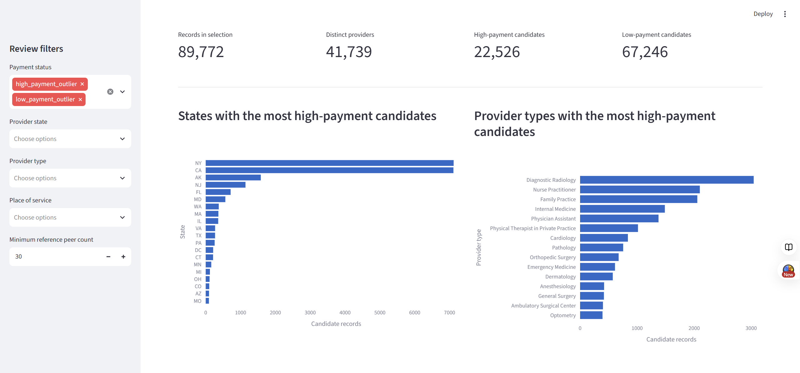

# AI-Powered Healthcare Payment Integrity & Provider Anomaly Analytics

## Project Overview

This project analyzes publicly available CMS Medicare Physician & Other Practitioners data to identify unusual provider/service payment patterns for human review.

It demonstrates a reproducible analytics workflow using Python, DuckDB, statistical peer benchmarks, an IQR-based outlier scoring pipeline, automated tests, and a Streamlit dashboard.

**Important:** A statistical outlier is a review candidate, not proof of fraud, provider misconduct, or an improper payment.

## Data Source

- CMS Medicare Physician & Other Practitioners — by Provider and Service
- Official dataset: https://data.cms.gov/provider-summary-by-type-of-service/medicare-physician-other-practitioners
- Data dictionary: https://data.cms.gov/resources/medicare-physician-other-practitioners-by-provider-and-service-data-dictionary
- Reporting year: 2024

The source contains aggregated provider/service records, not individual adjudicated claims. Raw and generated datasets are excluded from this repository; users must obtain the data from CMS separately.

## Methodology

1. Profile and validate source data.
2. Construct payment reference benchmarks by provider type, HCPCS code, and place of service.
3. Use a provider-level split to separate reference and evaluation populations.
4. Apply IQR-based bounds to flag unusually high or low average Medicare payments.
5. Prioritize flagged records for human review using transparent distance and peer-support rules.
6. Validate scoring reproducibility and classification logic.
7. Present review candidates and supporting peer statistics in a Streamlit dashboard.

## Technology Stack

- Python, pandas, NumPy
- DuckDB
- scikit-learn
- Streamlit
- Plotly
- unittest
- Git

## Repository Structure

- `src/` — reusable scoring pipeline
- `dashboard/` — Streamlit dashboard
- `tests/` — automated classification tests
- `documentation/` — methodology and data-quality documentation
- `data/` — local datasets, excluded from Git

## Run Locally

Create an appropriate Python environment and install the required dependencies for the scoring pipeline and dashboard.

Run the dashboard from the project root:

```bash
python -m streamlit run dashboard/app.py
```

The dashboard requires the evaluation dataset and reference benchmark files to exist at their expected local paths. Large datasets and model artifacts are not included in this repository.

Run the unit tests from the project root:

```bash
python -m unittest tests.test_score_provider_payments -v
```

## Interpretation and Limitations

- Average Medicare payment is not total paid amount.
- Statistical outliers require contextual review and are not confirmed improper payments.
- Peer benchmarks depend on provider type, HCPCS code, place of service, and reference sample size.
- Historical 2024 benchmarks should not be assumed valid for future periods without monitoring and recalibration.
- This project does not establish fraud probability, provider misconduct, financial recovery, or clinical appropriateness.

## Validation

The project includes unit tests for classification rules and documentation of scoring methodology and evaluation procedures. Validation of scoring logic does not establish the real-world accuracy of improper-payment detection.

## Dashboard Preview

The interactive dashboard helps reviewers explore provider payment patterns, filter potential outliers, inspect provider-level details, and export review worklists.

