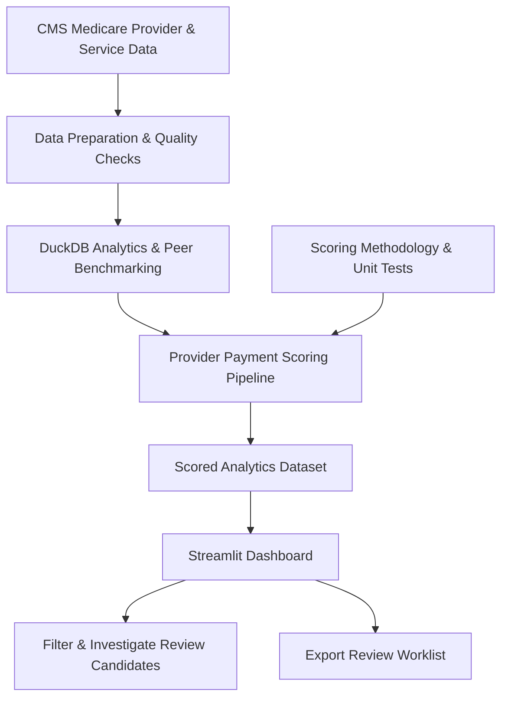

# Project Architecture

## AI-Powered Healthcare Payment Integrity & Provider Anomaly Analytics

### Overview

This project analyzes publicly available CMS Medicare provider-and-service data to identify unusual average payment patterns for further review. It uses Python and DuckDB for data processing, a reusable scoring pipeline for anomaly classification, and Streamlit for interactive investigation.

### Data Flow

### Core Components

1. **Data source:** Public CMS Medicare Physician & Other Practitioners data for 2024.
2. **Data preparation:** Validate fields, examine data quality, and prepare provider/service records for analysis.
3. **Analytics and benchmarking:** Use DuckDB to process large datasets and compare payment patterns against peer benchmarks.
4. **Scoring pipeline:** Apply documented classification rules to identify unusually low or high payment patterns and records without a usable reference benchmark.
5. **Dashboard:** Use Streamlit and Plotly to explore results, filter review candidates, inspect provider details, and export worklists.
6. **Testing and documentation:** Maintain unit tests and methodology documentation to support reproducibility and explain the scoring logic.

### Important Limitations

- The source contains aggregated provider-and-service records, not individual adjudicated insurance claims.
- An unusual payment pattern is a review signal, not proof of fraud, waste, abuse, or improper payment.
- Average payment comparisons do not establish clinical appropriateness or the amount of recoverable funds.
- The dashboard supports analytical review; final determinations require additional evidence and qualified human review.
